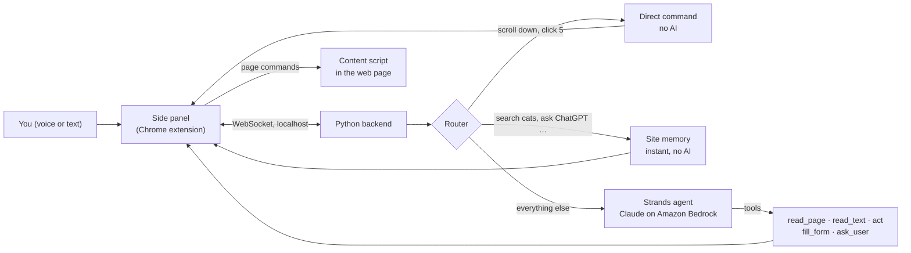

# VOYA

**You say the goal, VOYA does the clicks.**

> Siri can tell you the weather. It can't fill out your benefits form. VOYA can.

VOYA is a voice-first browser agent for people who can't easily use a mouse or keyboard, such as someone with a spinal cord injury, limited mobility or a motor impairment. You tell it what you want done. VOYA finds the right website, reads the page, clicks, types and fills in forms. It reads each form question to you, so you can answer out loud, and it **never submits anything without your yes.**

Built at **Hack Midwest 2026** for the AWS challenge, **best use of the Strands Agents SDK**. VOYA runs on a [Strands](https://strandsagents.com) agent with Claude models on **Amazon Bedrock**.

---

## What it looks like

Start on an empty tab and press the one button (or tap **Control twice**):

> **You:** "What benefits do I qualify for?"

1. VOYA searches the web, picks the official `.gov` eligibility checker, and clicks **Start**.
2. It reads you each question with its options, for example *"Are you married? Yes; Yes, but we don't live together; No, I'm widowed or divorced; or No, I've never been married."*
3. You answer by voice ("no, never married", or just "four"). VOYA picks the answer and clicks **Next**.
4. On the results page, it tells you what **the page** says you may qualify for.

While it works, the side panel shows every step the Strands agent takes, live.

---

## Features

**Built for people who can't use a mouse**
- **One button that does everything.** Press it to talk, press it again when you're done. It's the same in every state, always in the same place. Tapping **Control twice**, from any web page, does the same thing.
- **Answers by voice.** Options are read aloud as a numbered list. Say the answer, or its number ("two", "the second one").
- **Control words that work at any moment:** `stop`, `stop everything`, `cancel`, `quiet`, `repeat`, `help`, `start over`.
- **Hold early answers.** If you answer before the next question appears, VOYA keeps your answer for it.
- **Reads aloud when you ask:** "read it out loud for me".

**Does whole tasks, on sites it has never seen**
- **Fully agentic start.** From a blank tab it searches, chooses the most official source, and finds the start of the task. It never guesses addresses.
- **Works with real-world forms:** questions written as plain text above their options, hidden styled radio buttons, custom dropdowns, rich-text chat boxes (ChatGPT, Gmail), and validation errors.
- **Waits like a person would:** for new pages to load, and for pages that update in place to settle.
- **Site memory.** The first time VOYA visits a site, it learns where the search box and chat box are and what kind of site it is. After that, "search cat videos" or "ask ChatGPT …" run instantly, with no AI step.

**Safe and private by design**
- **It never submits without your yes.** A Strands hook stops any click on Submit, Send, Pay or Sign up until you approve it. This is enforced in code, not just requested in the prompt.
- **Nothing about you is stored.** Every form asks fresh, because several people in a household may share one browser. Site memory stores only page structure (selectors and labels), never what you typed or read.
- **Only the extension can drive the browser.** The backend refuses connections from websites.

---

## How it works



| Part | Where | Job |
|---|---|---|
| **Side panel** | `extension/sidepanel/` | The one button, mascot, status, questions, Strands steps and stats, settings |
| **Content script** | `extension/content.js` | Numbers every button, link and field; clicks, types, reads text; finds search and chat boxes; waits for pages to settle |
| **Background worker** | `extension/background.js` | Relays commands to the active tab and reports page loads |
| **Backend** | `backend/server.py` | WebSocket bridge, command queue, page-load waiting, control words |
| **Agent** | `backend/agent.py` | Routing, the Strands agent, its tools and hooks, site memory, instant commands |
| **Voice** | `backend/transcribe.py` | Records from the system microphone and turns speech into text |

**Three tiers, so simple things are instant:**
1. **Direct commands, no AI:** `click 5`, `scroll down`, `back`, `new tab youtube`, `settings overlay off`.
2. **Site memory, no AI:** `search cat videos`, `play wheelchair transfers on youtube`, `ask ChatGPT what is the biggest animal`.
3. **The Strands agent:** Claude Haiku 4.5 for quick one-step requests, Claude Sonnet 4.5 for multi-step tasks.

---

## How VOYA uses the Strands Agents SDK

| Strands feature | What VOYA does with it |
|---|---|
| **Agent loop + custom tools** (`@tool`) | The agent plans each step itself using `read_page`, `read_text`, `act` (click, type, search, ask, open, new tab), `fill_form` and `ask_user`. Nothing is scripted per site. |
| **Hooks: `BeforeToolCallEvent`** | **Safety guard:** before any click on a submit-type button, the hook asks the user, and cancels the tool call unless they say yes. |
| **Hooks: `Before`/`AfterToolCallEvent`** | Stream every tool call to the side panel live, with status and timing. |
| **Human in the loop** | `ask_user` pauses the agent for missing details and confirmations, answered by voice or typing. |
| **Structured output** | New websites are classified into a typed `SiteProfile` (name, type, summary) for site memory. |
| **Cancellation** (`agent.cancel()`) | `stop` and new commands interrupt the agent mid-task, cleanly. |
| **Metrics** (`event_loop_metrics`) | After each task the panel shows Strands' own numbers: model calls, tool calls, tokens, cache hit rate and time. |
| **Prompt caching** (`CacheConfig`) | Long form tasks reuse the cached prompt, tools and conversation. |
| **Amazon Bedrock models** | Claude Haiku 4.5 and Claude Sonnet 4.5, chosen per request. |

---

## Things to say

| Say | What happens |
|---|---|
| *"What benefits do I qualify for?"* | Finds the official checker and walks you through it |
| *"What's the weather in Chicago tomorrow?"* | Finds a forecast and tells you |
| *"search cat videos"* | Searches the site you're on (or Google) instantly |
| *"play wheelchair transfers on YouTube"* | Searches YouTube and opens a video |
| *"ask ChatGPT what is the biggest animal"* | Opens ChatGPT and sends the question |
| *"open Claude in a new tab"* | Opens it in a new tab |
| *"read it out loud for me"* | Reads the page or the last answer aloud |
| `scroll down` · `back` · `click 5` · `list` | Direct commands, instant |
| **`stop`** | Interrupts the current task |
| **`stop everything`** / **`start over`** | Stops the task, clears the queue, closes any question |
| **`cancel`** | "No" at a question (nothing is submitted); otherwise stop |
| **`quiet`** · **`repeat`** · **`help`** | Stop speaking · say it again · list the commands |
| `settings overlay on/off` | Show or hide the numbers on the page |
| `settings speak on/off` | Always read replies aloud, or only when asked |

---

## Setup

**You need:**
- Google Chrome
- Python 3.11 or newer
- An AWS account with **Amazon Bedrock** access to **Claude Haiku 4.5** and **Claude Sonnet 4.5** in `us-east-1`
- A microphone

**1. Install**
```bash
git clone https://github.com/aayush64x/VoiceControl.git
cd VoiceControl
python3 -m venv venv
source venv/bin/activate            # Windows: venv\Scripts\activate
pip install -r backend/requirements.txt
```

**2. Add AWS credentials**
```bash
cp .env.example backend/.env        # then fill in your keys
```
`backend/.env` is gitignored. Temporary credentials (for example from AWS Workshop Studio) expire after a few hours; paste fresh ones and restart the backend.

**3. Start the backend**
```bash
python backend/agent.py
```
Wait for `[agent] Ready.` The first time you use the mic, allow microphone access for your terminal app (on a Mac: System Settings → Privacy & Security → Microphone).

**4. Load the extension**
1. Open `chrome://extensions` and turn on **Developer mode**.
2. Click **Load unpacked** and choose the `extension/` folder.
3. Open any website and click the **VOYA** toolbar icon to open the side panel. The header shows **Online** when it's connected to the backend.

**Shortcuts**
- **Tap Control twice** (on a web page or in the panel) to start or stop listening.
- **Option+Shift+V** (Alt+Shift+V on Windows) opens the panel and starts listening, even from the address bar.
- On a Mac, if Dictation is set to "Press Control twice", change one of the two shortcuts.

---

## Tests

```bash
python -m pytest tests -q   # backend: routing, tools, safety hook, page waiting, site memory, control words
npm install && npm test     # extension: page reading, forms, typing, the side panel and bridge
```

---

## Project layout

```
backend/
  agent.py          routing, Strands agent, tools, hooks, site memory, instant commands
  server.py         WebSocket bridge, command queue, page-load waiting, control words
  site_memory.py    what each site is and where its search/chat boxes are
  transcribe.py     microphone capture and speech-to-text
extension/
  manifest.json     MV3 manifest, permissions, shortcut
  background.js     relays commands to the active tab, page-load events
  content.js        reads and acts on the page
  sidepanel/        the VOYA panel: one button, mascot, states, steps, settings
    js/bridge.js    connects the panel to the backend
tests/              pytest and jest suites
docs/               design brief, SSA questionnaire walkthrough, test log
```

---

## Limits we're honest about

- **Logins, captchas and two-factor codes** still need you. VOYA won't get past them, by design.
- **Forms inside embedded frames** and some unusual custom widgets can't be read yet.
- **Speech recognition** uses Google's free speech API. It can mishear names (VOYA corrects common ones like "Chad GPT" → ChatGPT) and needs the internet.
- **The side panel must be open** for the shortcuts to work, and the backend runs on the same computer as Chrome.
- **Page content is sent to the AI model** to decide what to do. A real deployment would need clear consent and careful handling of private details.
- We tested on real government, weather, video and search sites, but **not yet with the people VOYA is for.** That's the next step.

---

## Team

Built at Hack Midwest 2026 by **Rylan Begaye**, **Aayush Nakarmi** and **Ari Lee**

Side panel design: *Soft Glass Companion*, by our teammate.

Powered by the [Strands Agents SDK](https://strandsagents.com), Claude on [Amazon Bedrock](https://aws.amazon.com/bedrock/), and [Three.js](https://threejs.org) for the mascot.
